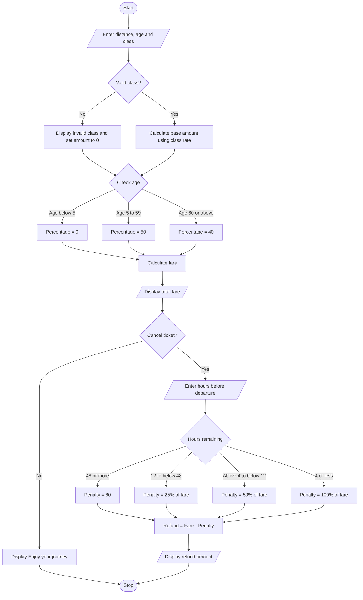

#Railway Fare and Reservation Calculator
# Problem Statement
The Railway Fare and Reservation Calculator is a Python program used to calculate the train ticket fare based on the travel distance, passenger age, and travel class. It supports four classes: Sleeper (SL), Third AC (3A), Second AC (2A), and First AC (1A).

The program calculates the fare using the selected class rate and applies an age-based percentage. It also allows passengers to cancel their tickets and calculates the refund amount based on the number of hours remaining before train departure.
# Algorithm
1. Start the program.
2. Read the travel distance, passenger age, and travel class.
3. Calculate the base amount using the selected travel class:
   - SL: Distance × 0.50
   - 3A: Distance × 1.30
   - 2A: Distance × 1.85
   - 1A: Distance × 3.10
4. If the travel class is invalid, display an error message and set the amount to zero.
5. Apply the age-based percentage:
   - Below 5 years: 0%
   - 5 to 59 years: 50%
   - 60 years and above: 40%
6. Calculate the final fare and display it.
7. Ask whether the passenger wants to cancel the ticket.
8. If the answer is Yes, enter the remaining hours before departure.
9. Calculate the cancellation penalty:
   - 48 hours or more: ₹60
   - 12 to less than 48 hours: 25% of the fare
   - More than 4 and less than 12 hours: 50% of the fare
   - 4 hours or less: 100% of the fare
10. Calculate and display the refund amount.
11. If the passenger does not cancel, display “Enjoy your journey!”
12. Stop the program.
Note: This algorithm follows the calculation rules in your supplied code, even though the age percentages are applied as the amount charged rather than as a discount.
# Mermaid Flowchart

# Input
The program accepts the following inputs:
Input	Description	Example
Distance	Distance travelled in kilometres	100
Age	Passenger's age in years	25
Travel class	SL, 3A, 2A or 1A	SL
Cancel ticket	Whether the passenger wants to cancel	No
Hours remaining	Hours until train departure; asked only when cancelling	50
# Expected Output
The output depends on the values entered by the user.
Example 1: Ticket is not cancelled
Sample input and output
Enter distance: 100
Enter age: 25
Enter travel class (SL/3A/2A/1A): SL
Total fare: 25.00
Want to cancel the ticket.
Enter Yes or No: No
Enjoy your journey!

Calculation:
- Base amount = 100 × 0.50 = ₹50
- Fare = ₹50 × 50/100 = ₹25
Example 2: Ticket is cancelled
Sample input and output
Enter distance: 100
Enter age: 25
Enter travel class (SL/3A/2A/1A): SL
Total fare: 25.00
Want to cancel the ticket.
Enter Yes or No: Yes
Enter hours remaining until train departure: 50
Refund amount: -35.00

Calculation:
- Fare = ₹25
- Cancellation penalty = ₹60 (48 hours or more)
- Refund = ₹25 − ₹60 = −₹35
This negative refund is what the current code produces. To prevent a negative refund, you could change the calculation to refund = max(0, fare - penalty). Then the refund in this example would be ₹0.00.
