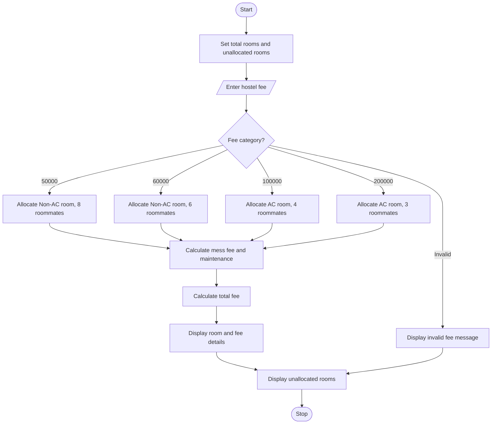

Hostel Allotment System
This Python program allocates hostel rooms based on the student's fee category. It displays the room number, room type, number of roommates, mess fee, maintenance fee, total fee, and remaining unallocated rooms.
# Problem Statement
Develop a Python program to allocate hostel rooms according to the fee paid by students. The hostel has 110 rooms, of which 70 are non-AC rooms and 40 are AC rooms. The program should calculate the total fee, including mess and maintenance charges, and display the remaining unallocated rooms.
# Algorithm
1. Start the program.
2. Set the total rooms to 110 and unallocated rooms to 40.
3. Read the student's hostel fee.
4. Check the fee category:
   - ₹50,000: Non-AC room with 8 roommates.
   - ₹60,000: Non-AC room with 6 roommates.
   - ₹1,00,000: AC room with 4 roommates.
   - ₹2,00,000: AC room with 3 roommates.
5. Calculate maintenance charges per student.
6. Calculate total fee using hostel fee + mess fee + maintenance fee.
7. Display room details and remaining unallocated rooms.
8. Stop.
# Flowchart

# Input
Fee category	Room type	Roommates	Mess fee
₹50,000	Non-AC	8	₹20,000
₹60,000	Non-AC	6	₹20,000
₹1,00,000	AC	4	₹20,000
₹2,00,000	AC	3	₹20,000
# Expected Output
Example input: 50000
Total rooms are 110.
Allocated rooms are 70.
Unallocated rooms are 40.
Enter your fee (50000, 60000, 100000, 200000): 50000
You are allocated to room number 33, Non-AC room with 8 roommates and mess fee of ₹20000.
Your maintenance fee is ₹125.
Your total fee is ₹70125.
Thank You!
At present unallocated rooms are 39.
