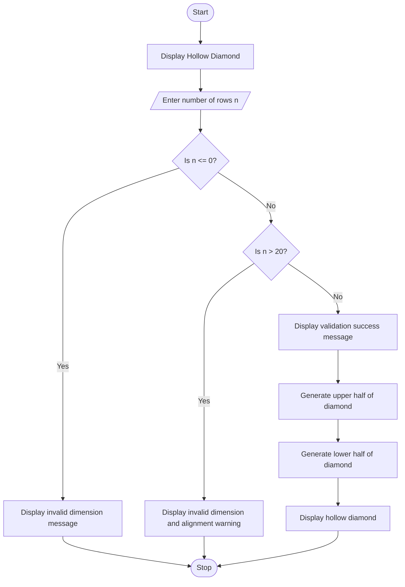

Advanced Numeric Pattern Generator – Hollow Diamond
# Problem Statement
The Advanced Numeric Pattern Generator is a Python program that generates a hollow diamond pattern using stars (*). The user enters the number of rows, and the program validates the input. If the number of rows is less than or equal to 0 or greater than 20, it displays an error message. Otherwise, it prints a properly aligned hollow diamond pattern.
# Algorithm
1. Start the program.
2. Display the title “Hollow Diamond”.
3. Read the number of rows n from the user.
4. If n is less than or equal to 0, display an invalid-dimension message.
5. If n is greater than 20, display an error message and alignment warning.
6. Otherwise, display the validation success message.
7. Print the upper half of the diamond:
   - Print leading spaces.
   - Print stars at the first and last positions.
   - Print spaces between the stars.
8. Print the lower half of the diamond using a reverse loop.
9. Stop the program.

# Mermaid Flowchart

# Input
The program accepts the number of rows from the user.
Input	Description	Example
n	Number of rows in the upper half	5
Minimum valid value	Must be greater than 0	1
Maximum valid value	Must not exceed 20	20

# Expected Output
Example 1: Valid input
Input: 5
Hollow Diamond
Enter number of rows :5
Dimensions validated! Generating pattern...
                *
            *       *
        *               *
    *                       *
*                               *
    *                       *
        *               *
            *       *
                *

The pattern has five rows in the upper half and four rows in the lower half, making a total of \(2n-1=9\) rows.
Example 2: Invalid input — zero or negative
Hollow Diamond
Enter number of rows :0
Invalid Dimension: Number of rows must be greater than 0

Example 3: Invalid input — greater than 20
Hollow Diamond
Enter number of rows :25
Invalid Dimension: Number of rows must be less than or equal to 20
The number is too larger for screen alignment.
