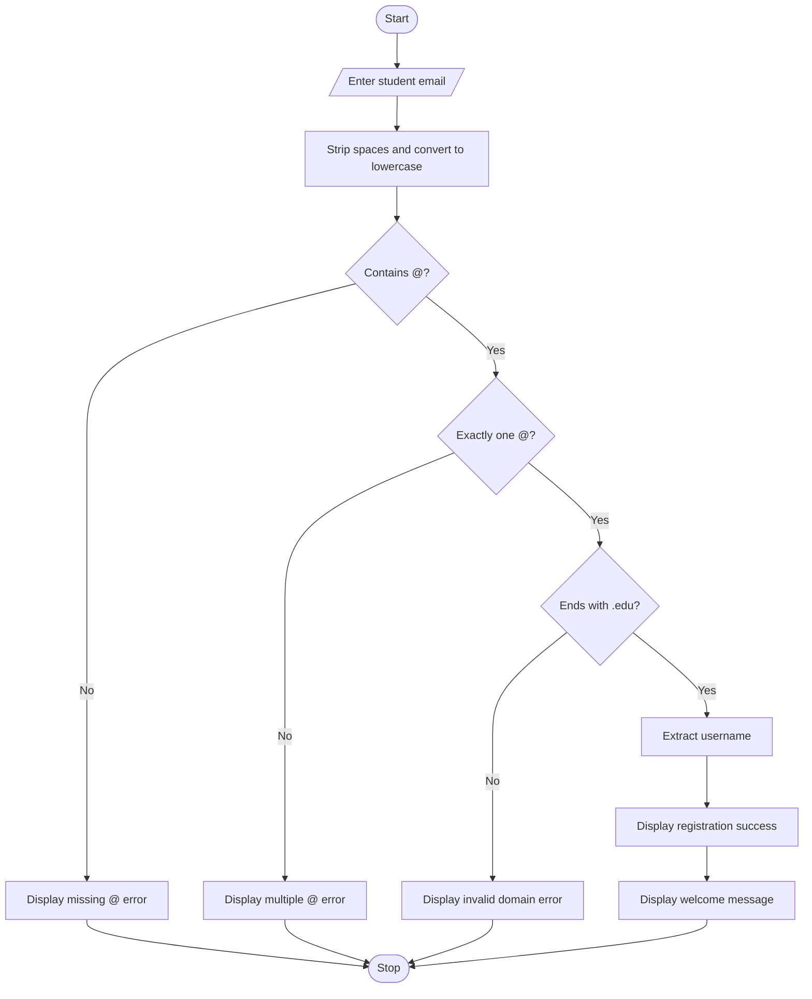

Student Email and Identifier Validation
# Problem Statement
The Student Email and Identifier Validation program is a Python program that checks whether a student's email address follows the given formatting rules. It removes leading and trailing whitespace, converts the email to lowercase, and checks for the @ symbol, the correct number of @ symbols, and the institutional .edu ending. If the email is valid according to these checks, the program displays a success message and welcomes the student using their username.
# Algorithm
1. Start the program.
2. Read the student's email address.
3. Remove leading and trailing spaces using strip().
4. Convert the email address to lowercase using lower().
5. Check whether the email starts with a space. If so, display an error message.
6. Check whether the email contains the @ symbol. If not, display an error message.
7. Check whether the email contains exactly one @ symbol. If not, display an error message.
8. Check whether the email ends with .edu. If not, display an error message.
9. If all checks pass, extract the username before the @ symbol.
10. Display the registration success message and welcome the student.
11. Stop the program.
Note: Because strip() removes leading spaces before validation, the startswith(" ") condition will not normally be true.
# Mermaid Flowchart

# Input
Input	Description	Example
Student email	Email address entered by the student	deepthi@nri.edu
@ symbol	Separates username and domain	Required
.edu ending	Identifies the permitted institutional email ending	Required

# Expected Output
Example 1: Valid email
Sample output
Enter student email address :deepthi@nri.edu

----Registration Status : SUCCESS----
Welcome deepthi! Your student account has been successfully created.

Example 2: Missing @ symbol
Enter student email address :deepthinri.edu
Email should contain @ symbol.

Example 3: Multiple @ symbols
Enter student email address :deepthi@@nri.edu
Email should contain only one @ symbol.

Example 4: Invalid domain
Enter student email address :deepthi@nri.com
Only institutional .edu emails are permitted.
