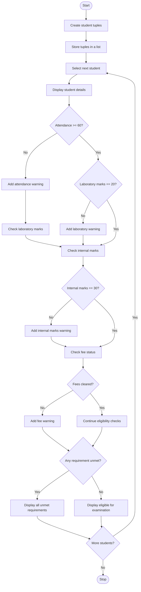

Multi-Stage Examination Eligibility System
# Problem Statement
The Multi-Stage Examination Eligibility System is a Python program that determines whether students are eligible to write their final examination based on four conditions: attendance, laboratory completion, internal assessment marks, and fee clearance.

The program stores student details in tuples and processes each student using a loop and conditional statements. It checks the eligibility requirements and displays every unmet requirement along with suitable instructions. Students who satisfy all the conditions are declared eligible for the final examination.

Eligibility conditions in the given code:
- Attendance must be at least 60%.
- Laboratory marks must be exactly 20 out of 20.
- Internal marks must be exactly 30.
- Fees must be cleared ("yes").
# Algorithm
1. Start the program.
2. Store the details of five students in separate tuples.
3. Add all student tuples to a list.
4. Display the heading “Student eligibility for final examination”.
5. Use a for loop to process each student's details.
6. Extract the student ID, attendance, laboratory marks, internal marks, and fee status.
7. Display the student's details.
8. Check whether attendance is at least 60%.
   - If not, display the attendance warning and ineligibility message.
9. If attendance is sufficient, check whether laboratory marks equal 20.
   - If not, display the laboratory completion warning.
10. If laboratory marks are sufficient, check whether internal marks equal 30.
    - If not, display the internal marks warning.
11. If internal marks are sufficient, check whether fees are cleared.
    - If not, display the fee clearance warning and ineligibility message.
12. If all conditions are satisfied, display the eligibility confirmation.
13. Repeat the process for all students.
14. Stop the program.
# Mermaid Flowchart

# Input
The program uses the following student details as input data stored in tuples.
Student ID	Attendance (%)	Laboratory (/20)	Internal (/40)	Fee cleared
2601	65	15	35	Yes
2602	70	20	26	Yes
2603	62	20	30	No
2604	60	20	30	Yes
2605	50	20	38	Yes

# Expected Output
The following output corresponds to your original code, which reports only the first unmet condition encountered in its nested checks.
Student eligibility for final examination:

Student eligibility for final examination:

Student ID: 2601
Attendance(in percentage): 65
Laboratory(out of 20): 15
Internal marks(out of 40): 35
Fee clear: yes
You have not completed your Laboratory yet.
Complete your lab work.

Student ID: 2602
Attendance(in percentage): 70
Laboratory(out of 20): 20
Internal marks(out of 40): 26
Fee clear: yes
Your internal marks are low.
Concentrate on your exams.

Student ID: 2603
Attendance(in percentage): 62
Laboratory(out of 20): 20
Internal marks(out of 40): 30
Fee clear: no
Your fee is not cleared.
Complete your fee to write the examination.
Sorry you are not eligible for final examination.

Student ID: 2604
Attendance(in percentage): 60
Laboratory(out of 20): 20
Internal marks(out of 40): 30
Fee clear: yes
You are eligible for final examination.

Student ID: 2605
Attendance(in percentage): 50
Laboratory(out of 20): 20
Internal marks(out of 40): 38
Fee clear: yes
Your attendance is low.
Be regular today onwards.
Sorry you are not eligible for final examination.
