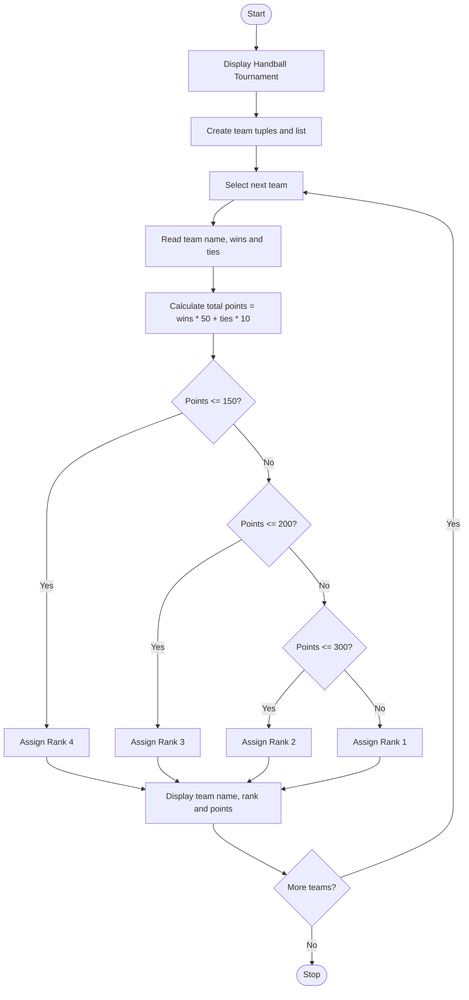

Sports Tournament Ranking System
# Problem Statement
The Sports Tournament Ranking System is a Python program designed to calculate team scores and determine their rankings in a handball tournament. Each team is awarded 50 points for a win, 10 points for a tie, and 0 points for a loss.

The program stores team names, wins, and ties in tuples. It calculates the total points for each team and assigns a rank according to the specified competition policy. The ranking is based on point ranges, with Rank 1 awarded to teams scoring above 300 points.
# Algorithm
1. Start the program.
2. Display the heading “Handball Tournament”.
3. Store each team's name, number of wins, and number of ties in tuples.
4. Add all team tuples to a list.
5. Use a for loop to process each team.
6. Extract the team name, wins, and ties.
7. Calculate total points using the formula:
   Total Points = (Wins × 50) + (Ties × 10)
8. Assign ranks according to the following conditions:
   - Points less than or equal to 150: Rank 4
   - Points from 151 to 200: Rank 3
   - Points from 201 to 300: Rank 2
   - Points above 300: Rank 1
9. Display the team name, rank, and total points.
10. Repeat for all teams.
11. Stop the program.
# Mermaid Flowchart

# Input
The team information is provided as tuples in the program.
calculation
Formula:
Total Points=(Winsx50)+(Tiesx10)

Team	Wins	Ties	Total points	 Rank
A	     5	    1	    260          Rank 2
B	     3	    1	    160	         Rank 3
C	     2	    1	    110	         Rank 4
D	     8	    1	    410	         Rank 1
# Expected output
Handball Tournament

TEAM NAME: A
Rank 2
Total points: 260

TEAM NAME: B
Rank 3
Total points: 160

TEAM NAME: C
Rank 4
Total points: 110

TEAM NAME: D
Rank 1
Total points: 410
