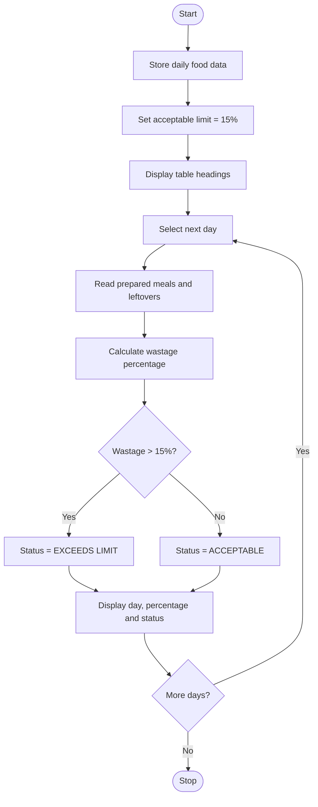

Food Waste Monitoring System
# Problem Statement
The Food Waste Monitoring System is a Python program that monitors food wastage over several days by comparing the quantity of prepared meals, served meals, and leftover meals. It calculates the wastage percentage for each day and compares it with an acceptable wastage limit of 15%.

If the wastage percentage exceeds 15%, the program displays “EXCEEDS LIMIT”. Otherwise, it displays “ACCEPTABLE”. This system helps identify days with excessive food waste and encourages better food management.
# Algorithm
1. Start the program.
2. Store the prepared meals, served meals, and leftovers for each day in a dictionary.
3. Set the acceptable wastage limit to 15%.
4. Display the table headings: Day, Wastage %, and Status.
5. Iterate through each day's data using a for loop.
6. Extract the number of prepared meals and leftovers.
7. Calculate the wastage percentage using the formula:
Wastage %=(Leftovers/Prepared meals)x100

8. If the wastage percentage is greater than 15%, set the status to “EXCEEDS LIMIT”.
9. Otherwise, set the status to “ACCEPTABLE”.
10. Display the day, wastage percentage, and status.
11. Repeat for all days.
12. Stop the program.
# Mermaid Flowchart

# Input
The program uses the following predefined data:
Day	Prepared meals	Served meals	Leftovers
Monday	500	420	80
Tuesday	480	450	30
Wednesday	550	410	140
Thursday	600	560	40
Friday	520	400	100

Acceptable wastage limit: 15%
# Expected Output
DAY          | WASTAGE %  | STATUS
Monday       |     16.0% |  EXCEEDS LIMIT
Tuesday      |      6.2% |  ACCEPTABLE
Wednesday    |     25.5% |  EXCEEDS LIMIT
Thursday     |      6.7% |  ACCEPTABLE
Friday       |     19.2% |  EXCEEDS LIMIT

Sample calculation
For Monday:
\[
\frac{80}{500}\times100=16\%
\]

Since 16% is greater than the acceptable limit of 15%, the status is EXCEEDS LIMIT.
