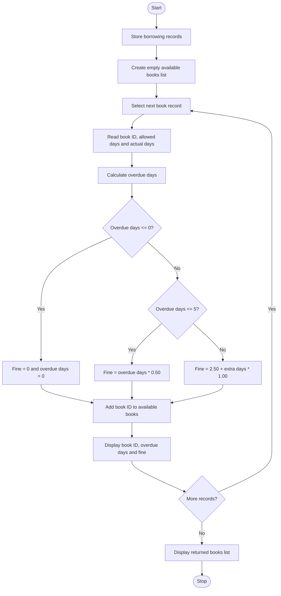

Library Borrowing and Fine Reconciliation
# Problem Statement
The Library Borrowing and Fine Reconciliation system is a Python program that processes book borrowing records to calculate overdue days and library fines. Each record contains a book ID, the allowed borrowing period, and the actual number of days the book was borrowed.

The program calculates fines based on the number of overdue days. No fine is charged for books returned on time. A fine of $0.50 per day is charged for the first five overdue days, and $1.00 per day for each additional overdue day. It also updates the availability list by adding returned books back to the library shelf.

# Algorithm
1. Start the program.
2. Store book borrowing records as tuples containing book ID, allowed days, and actual days taken.
3. Create an empty list called available_books.
4. Process each borrowing record using a for loop.
5. Extract the book ID, allowed days, and actual days.
6. Calculate overdue days:
Days Overdue=Actual Days-Allowed Days

7. If overdue days are less than or equal to zero:
   - Set the fine to $0.00.
   - Set overdue days to zero.
8. Otherwise, if overdue days are less than or equal to five, calculate the fine at $0.50 per day.
9. If overdue days exceed five, calculate the fine as $2.50 plus $1.00 for each additional day.
10. Add the returned book ID to available_books.
11. Display the book ID, overdue days, and calculated fine.
12. Repeat the process for all borrowing records.
13. Display the list of books returned to the shelf.
14. Stop the program.
3. Mermaid Flowchart

# Input
The program uses the following predefined borrowing records.
Book ID	Allowed days	Actual days taken	Overdue days
BK101	14	18	4
BK102	7	7	0
BK103	10	19	9

# Expected Output
Book ID: BK101
Days Overdue: 4
Fine Calculated: $2.00

Book ID: BK102
Days Overdue: 0
Fine Calculated: $0.00

Book ID: BK103
Days Overdue: 9
Fine Calculated: $6.50

Books Reconciled & Returned to Shelf:
['BK101', 'BK102', 'BK103']

Sample calculations
- BK101: 4 overdue days × $0.50 = $2.00
- BK102: Returned on time, so the fine is $0.00.
- BK103: First 5 days × $0.50 + remaining 4 days × $1.00 = $2.50 + $4.00 = $6.50.
Total fines collected: $8.50.
