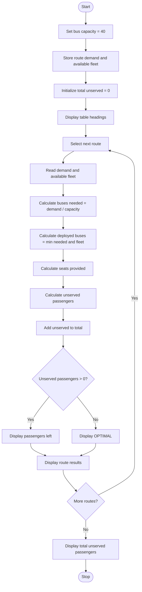

Campus Transport Allocation
# Problem Statement
The Campus Transport Allocation system is a Python program that determines the number of buses required to transport students on different campus routes. Each bus has a capacity of 40 passengers, and each route has a specific passenger demand and an available bus fleet.

The program calculates the buses required, determines how many buses can be deployed based on fleet availability, calculates the number of unserved passengers, and displays the transport allocation status for each route. It also maintains a total count of unserved passengers across all routes.
# Algorithm
1. Start the program.
2. Set the bus capacity to 40 passengers.
3. Store each route's passenger demand and available fleet in a dictionary.
4. Initialize total_unserved to zero.
5. Display the table headings.
6. For each route:
   - Read the passenger demand and available fleet.
   - Calculate buses needed by dividing demand by bus capacity.
   - Determine buses deployed using the minimum of buses needed and available fleet.
   - Calculate the seats provided.
   - Calculate unserved passengers using the maximum of zero and demand minus seats provided.
   - Add unserved passengers to total_unserved.
   - Display the route details and status.
7. Display the total number of unserved passengers.
8. Stop the program.
# Mermaid Flowchart

# Input
The program uses the following predefined data.
Route name	Passenger demand	Available buses
IBM	60	2
Kondapalli	50	3
Bench circle	70	5

- Bus capacity: 40 passengers
- Total passenger demand: 180 passengers
# Expected Output
The following output matches your original code, including its use of division (/) instead of rounding up to whole buses.
ROUTE NAME             | DEMAND | NEEDED | DEPLOYED | UNSERVED
Ibm                    | 60     | 1.5    | 1.5      | OPTIMAL
Kondapalli             | 50     | 1.25   | 1.25     | OPTIMAL
Bench circle           | 70     | 1.75   | 1.75     | OPTIMAL
